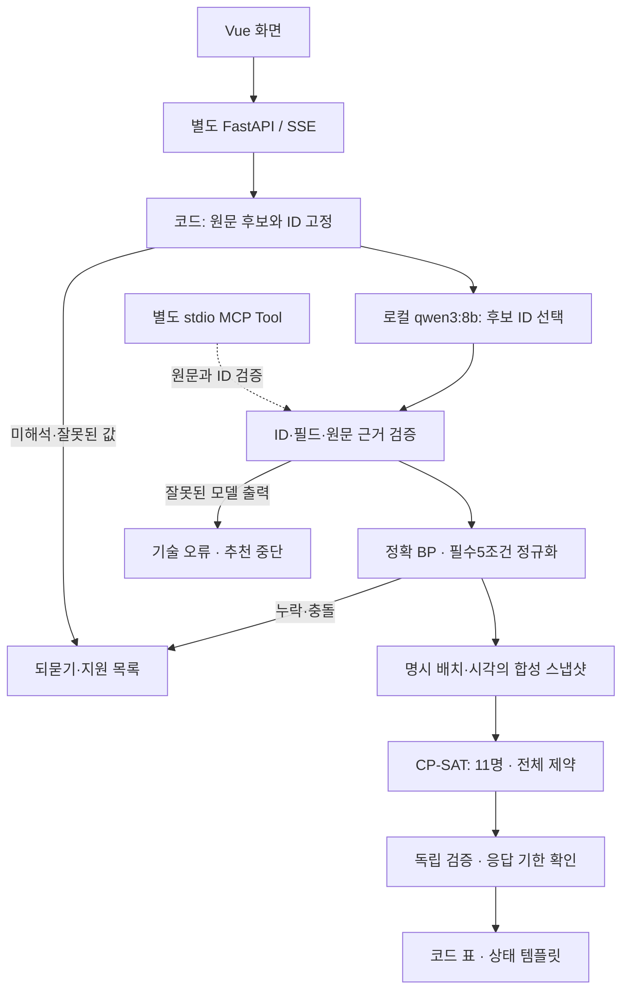

# AI Mini-Project 결과 보고서 — 검증 가능한 합성 스쿼드 추천 Agent

작성일:2026-10-21. 제출 준비 마감:2026-10-22 13:00 KST. 이 문서는 저장소의 구현·측정 결과를 정리한 제출용 Markdown 초안이다. 외부 제출/등록·발표·배포 완료를 뜻하지 않는다. 후속 사용자 확정:2026-10-22(목)13:00 KST 시작·5분·PPTX. [발표 구성·대본](presentation-5min.md)에7장 자료와 로컬 파일 정보를 기록했다.

## 1. 문제와 구현 목표

예산·급여·클럽·포메이션·강화 조건으로 11명을 구성하려면 선수 한 명씩 좋은 후보를 고르는 것만으로는 부족하다. 같은 인물 중복, 자리별 배치, 팀 전체 예산/급여를 함께 만족해야 한다. 또한 언어 모델의 형식상 올바른 JSON이 원문 조건까지 올바르게 반영한다는 보장도 없다.

이번 과제는 **정형 한국어 조건문을 검증된 합성 스쿼드 또는 명확한 실패 상태로 바꾸는 Agent**를 구현했다. LLM은 코드가 만든 원문 후보 ID를 필드에 연결하고, 조건 해석/조합 최적화/독립 검증/수치 출력은 코드가 담당한다. 실제 선수·시세 기반 추천 품질을 입증하는 과제가 아니다.

필수 입력은 예산·급여 상한·정식 클럽명·포메이션·허용 강화의5개다. 리버풀/첼시/바이에른 뮌헨, 4-2-3-1/4-1-2-3/4-2-2-2, 추천 강화5~11을 지원한다. 별칭·자유 대화·세션 정정·국적/성향·선수 제외는 지원하지 않고 누락/미지원/모호한 절을 무시하지 않는다.

```text
예산 1조, 급여 300, 리버풀, 4-2-3-1, 5강으로 구성해줘
```

## 2. 구조와 책임 분리



실제 평가의25문장은 내부 Agent→최종 응답 직렬화 경로로 측정했다. 위 전체 웹 경로의25문장 브라우저 평가나 LLM의 자율적 MCP Tool 호출을 측정한 것은 아니다. 실제 브라우저3사례와 stdio12사례는 아래의 별도 검증 증거다.

| 층 | 구현 책임 | 보장/제한 |
|---|---|---|
| Vue 3/Vite/TypeScript | 입력·진행 단계·상태·표·서버 준비 표시 | 원문/숫자를 추측 보정하지 않음. 웹 담당과 보호 경로 분리 |
| FastAPI/SSE | 엄격 DTO·단일실행·요청/응답 한도·안전한 종료 | 별도8001 앱. 기존8000 카드 API와 분리. 상주/공개 배포 없음 |
| 후보 준비/정규화 | 원문 구간·후보 ID·정확 정수 BP·5조건 | 정형 문법만 지원. 기본값/마지막 값 자동 선택 없음 |
| LangGraph/DI | 추출→정규화→조건부 build | 단일 요청의 명시 워크플로우. 독립 Multi-Agent가 아님 |
| 로컬 Ollama | qwen3:8b의 후보 ID 선택 | 등록 포지션 확률/선수 성능 점수/선수 선택을 LLM이 생성하지 않음 |
| 합성 자료/스냅샷 | seed·규칙·배치·출처 해시·관측/기한 고정 | 실존 선수/시세를 사용하지 않음. 자동 최신 선택/갱신 없음 |
| CP-SAT/검증기 | 자리·동일 인물·클럽·강화·전체 BP/급여 | 점수는 포지션 OVR/2, 목적은 OVR 합. 확률이나 실제 경기 성능과 다름 |
| 표/설명 | 검증된 행/합계를 문자열 수치와 코드 템플릿으로 출력 | LLM narrate/check·서술 재생성은 구현하지 않음 |
| MCP | build_squad Tool1개·지원 Resource·후보 선택 Prompt | 로컬 stdio. 호스트 등록·HTTP MCP·실제 LLM Tool-use는 미검증 |

강화 능력치는 기본1강+공통 누적 보너스로1~13강을 파생할 수 있지만 추천 허용은5~11강이다. 가격·급여·클럽 자격은 능력치 증가표로 생성하지 않는다. 데모의 가격/급여/자격은 별도의 가상 규칙이다.

## 3. 기존 자산과 이번 신규 작업

기존 자산은 데이터 스키마/수집 이력, 포지션 분류 학습·평가/읽기 전용 API, 스냅샷·점수·배치 계약, CP-SAT/독립 검증기와 합성60문제 벤치마크다. 이를 이번에 새로 만든 모델이나 실데이터 서비스로 포장하지 않는다. 실제 데이터 경로1-D/1-F와 제공자 수집 허용 확인은 미완료로 보존한다.

이번 과제에서 추가한 것은 강화 파생/고정 합성 자료 공급, LangGraph/DI 연결, 원문 후보 ID 선택과 Ollama 어댑터, 코드 표/템플릿, Agent HTTP/SSE와 웹 접점, 로컬 MCP, 사전 정답25문장/대역·실모델 평가 실행기/실패 기록이다. XGBoost나 qwen3:8b를 이번 과제에서 새로 사전학습/미세조정한 것은 아니다.

## 4. 평가 방법과 실제 결과

사례는 측정 전에 정상8·해없음3·미지원5·필수누락4·모호/금액/정정5로 고정했다. 준비 차단9개는 모델 호출 없이 처리하고 나머지16개에 qwen3:8b를1회 적용했다. 서버 상태2회·추론16회·순차/각120초 상한·재시도/fallback/다운로드/외부 전송0이었다. 모델 digest/원문·자료·소스 해시/사례별 결과와 잠금을 로컬에 보관하고 이번 서버는 종료했다.

| 증거 | 결과 | 범위 |
|---|---|---|
| 대역 계약 평가 | 25/25, 선택 대역16/16, 유효11명8/8 | 사전 정답 ID를 공급한 코드/엔진 계약 검사. 실제 모델 정확도 아님 |
| 실제 모델 출력 스키마 | 16/16 | 형식 통과 |
| 실제 모델 ID 근거/선택 대상 의미 | 15/16 (93.75%) | 모델이 호출된16개 |
| 전체 조건 의미/E2E | 24/25 (96%) | 코드 차단9개 포함, 실패를 분모에 유지 |
| 정상/해없음/미지원/누락/함정 | 8/8, 3/3, 5/5, 3/4, 5/5 | M02의 기술 오류를 올바른 누락 안내로 세지 않음 |
| 반환해 제약 준수 | 8/8 | 반환된 스쿼드만의 지표. 전체 질의 성공률과 구분 |
| 모델 호출 대상 경로 p50/p95 | 7.734s / 10.253s (n16) | 로컬 기록·Agent·최종 직렬화, 사후 채점 제외 |
| 모델 호출 자체 p50/p95 | 7.677s / 10.044s (n16) | 보고된 로드 시간을 빼지 않은 요청 지연 |
| 보고된 입력/출력 토큰 합계 | 9,260 / 2,117 | 각각16/16개가 값을 제공. 총 전력/장비 비용은 미측정 |
| 실제 브라우저 연결 | 정상/누락/충돌3사례 확인 | 이전 W4 별도 실행. 이번25개를 브라우저에서 재실행하지 않음 |
| 실제 stdio MCP 대조 | 직접/MCP12/12 일치·프로세스 종료 | 모델/HTTP 요청 없는 고정 합성 자료의 프로토콜 검증 |
| 현재 Python 검사 | pytest1,662·Ruff·환경/pip 통과 | 실모델 요청은 단위 테스트에 포함하지 않음 |
| 웹 로컬 검사 | 타입·108테스트·빌드 통과 이력 | 웹#83/W5 통합 기록. 새 웹 CI/추가 브라우저 검증 아님 |

p50/p95는 nearest-rank로 계산했다. 준비 단계에서 끝나는9개의 짧은 지연을 모델 속도로 합치지 않았다. 전체25개 경로 p50/p95는7.386/9.313초이며 모델 대상16개와 분모가 다르다. 의미90%/E2E85%는 초안 목표였고 최종 합격 기준으로 소급 확정하지 않았다.

## 5. 실패 사례와 의사결정

M02의 `급여 300, 첼시, 4-1-2-3, 5강으로 구성해줘`는 예산 누락을 되물어야 했다. 모델은 급여 후보 ID를 예산 필드에도 배정했다. JSON 형식은 맞았지만 원문 필드와 일치하지 않아 `field_mismatch`로 거부했고, 자료 조회/탐색/스쿼드 반환은0이었다. 안전 차단은 작동했지만 올바른 명확화에 실패했으므로 의미/E2E 실패1건으로 남겼다.

이 사례는 스키마 통과와 의미 정확도를 분리해야 하는 근거다. 모델 출력의 잘못된 필드를 지우거나 기본 예산으로 바꾸어 성공률을 높이지 않았다. 실제 응답 원본은 커밋하지 않고 같은 오류 구조의 합성 회귀 테스트를 추가했다. 측정 후 프롬프트/정답/모델을 바꾸거나 추가 추론하지 않았다.

초기 직접 구간 생성 실험과 후보 ID 방식의 사례/경로가 달랐으므로0/5→15/16을 통제된 개선율로 제시하지 않는다. 같은 서술에 대한 사실 검사 Before/After나 LLM이 직접 스쿼드를 고르는 비교는 실행하지 않았다. 기존 CP-SAT/탐욕60문제도 이번 모델 평가와 다른 증거다.

## 5-1. 추가 기술 요소: RAG·LangSmith

별도 문서 Q&A API/CLI에 허용 문서3개·13구간의 문자 TF-IDF 상위3 검색, qwen3:8b 생성, 출처 검증을 추가했다. 강화/지원 조건/자료 범위를 답하며 기존 추천의 조건·계산·최적화는 변경하지 않는다. 선택적 LangSmith 관측은 원문/답변/검색 본문 없이 단계별 상태·지연·제공 토큰과 관계 ID만 전송한다.

[실제1회 기록](rag-langsmith-results.md)은 고정7질문5/7(71.43%), 답할 근거가 있는4질문 중3/4다. K03은 정답 출처를 검색했지만 답변하지 않았고, K05는 근거 부족에 출처를 남겨 형식 오류로 거부했다. 검색 정답 출처 포함4/4를 전체 RAG 성공으로 세지 않았다. 내용 검토에서 반환된3개 답변은 인용 구간과 일치했다.

상태 조회2·추론6회·재시도0, 모델 요청 p50/p95는3.486/8.021초(n6, 로드 포함)다. LangSmith 미국 FRS 프로젝트에26개 run의 POST 성공 응답과 첫 root의 GET200·ID 일치를 확인했다. 모든 run의 UI를 각각 읽은 것은 아니다. 이번 Ollama는 종료했고 실제 실행 승인은 소진됐다. 과거 W6의24/25와 다른 질문/경로의 결과로 구분한다.

## 6. 한계와 후속

- 공개 정형 회귀25문장·모델1회·합성 자료다. 비공개 일반화 성능, 자유 한국어 대화, 실제 시세/선수 추천 품질을 입증하지 않는다.
- 의미의 상당 부분을 코드 후보 준비/정규화가 담당한다. 모델15/16과 전체24/25를 구분하며 자율 추론/도구 선택을 과장하지 않는다.
- 모델의 누락 필드 처리1건이 실패했다. 추가 정책/스키마·모델 비교나 재평가는 별도 범위다. 이번 호출 승인은 소진됐다.
- 정규화는 필수5조건·정식 값만 지원한다. 별칭/다중 턴/국적/성향/선수 제외와 공식 팀컬러 발동 보너스는 지원하지 않는다.
- LLM 서술/사실 검사·런타임 Multi-Agent·일반 MCP 호스트·공개 배포는 미구현/미검증이다. 별도 [W8 문서 Q&A·LangSmith](rag-langsmith-results.md)는 실제7질문5/7·추론6회·POST26 성공 응답/첫 root GET200을 확인했다. 새 Q&A 웹 연결과 기존 추천 경로의 전체 tracing은 미검증이다.
- 실데이터1-D/1-F·수집 허용·데이터 갱신/실데이터 스쿼드 통합을 완료로 바꾸지 않았다. 실제 자료가 없는 새 환경에서도 합성 대역 검증은 가능하다.
- 모델 로드/자원 변동과 응답 기한·만료가 있다. 실패를 기본값이나 모의 성공으로 숨기지 않으며 운영 SLA/총비용0원을 주장하지 않는다.

## 7. 재현과 제출 확인

기본 재현은 [재현·시연 안내](demo-reproduction-guide.md)의 **추가 모델 요청 없는 경로**다. 외부 제출/Google 스프레드시트 등록·녹화·발표는 실행하지 않았다. 후속 요청으로5분 PPTX와 노트 대본을 준비했으며 추가 라이브 실행은 별도 범위다. master 반영은 생성한 PR의 실제 병합 여부를 확인하고 배포와 혼동하지 않는다.

근거와 상세 해시:

- [25문장·사전 정답](stage-w6-evaluation-cases.md), [지표 계약](stage-w6-evaluation-contract.md)
- [대역 실행기·초기 실패·최종 기록](stage-w6-evaluation-implementation.md)
- [실모델 실행기·실제 측정/실패·소스/자료 해시](stage-w6-model-evaluation.md)
- [Agent API](synthetic-agent-api.md), [실제 브라우저3사례](agent-browser-e2e.md)
- [MCP 구현·12사례 대조](stage-w5-mcp-implementation.md)
- [기존 엔진 벤치마크](stage-3-e-benchmark-results.md)
- [설계도](FRS_2.0_설계도.md), [공용 기록](agent-collaboration.md), [로드맵](ai-mini-project-roadmap.md)
