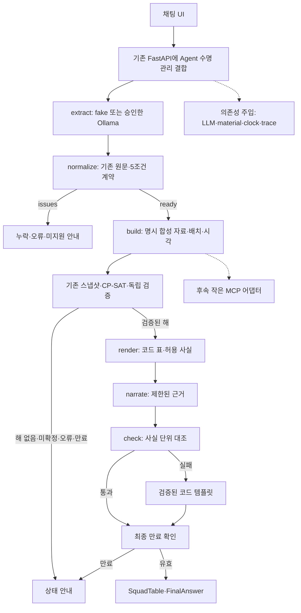

# AI Mini-Project 재설계안 - FC온라인 스쿼드 추천 Agent

작성일: 2026-10-20. 사용자 초안 `docs/ai-mini-project-plan.md`는 보존하고, 교재·참고 코드·현재 FRS 구현을 대조한 실행 계획을 별도로 작성한다. 최초 작성은 계획 문서였으며 후속 사용자 요청으로 [웹 제외 백엔드 구현](backend-resume-plan.md)을 재개한다. 완료 결과와 미정 정책은 각 증분에서 구분한다.

## 1. 목표와 확정 범위

**기존 결정론 엔진 위에, 합성 가상 리그를 사용하는 설명 가능한 Agent MVP를 완성한다.** 이번 과제의 신규 성과는 자연어 추출·그래프·도구 연결·검증된 출력·평가이며 기존 엔진/학습 모델과 구분한다. 과제 유형은 초안의 2번 신규 주제를 기준으로 계획한다. 실제 등록 여부는 확인하지 않았다.

| 구분 | 기준 |
|---|---|
| 사용자 확정 | 발표용 합성 Agent MVP 우선. 실데이터 산출물/장기 목표 보존, 1-D·1-F는 별도 후속 |
| 사용자 확정 | 실제 LLM 검증은 로컬 Ollama 우선, 하드웨어 확인 후 모델 결정 |
| 사용자 확정 | 개발 가능 시간 09~18시. 부족하면 추가 작업 가능하지만 야간 작업을 필수 일정으로 잡지 않음 |
| 후속 사용자 요청 | 웹 제외 백엔드 구현 재개. 강화 계산·합성 자료·테스트 대역 그래프부터 진행. 실제 모델은 두 설치 모델에 총 최대 10회 로컬 비교만 별도 승인 |
| 기존 계약 유지 | 필수5조건·정식값·정확 BP·원문 근거·같은 인물 최대1명·전원 클럽 자격·명시 배치·독립 검증·만료 |
| 현재 미정 | 실제 Day1/Day3 날짜, 모델/추론 설정, 별칭, 다중 턴, 재시도/전체 시간 상한, 외부 tracing 허용 |

장기 실데이터 경로 D1을 삭제하거나 수집 허용 판정을 바꾸지 않는다. 과제용 합성 실행 경로는 명시적으로 선택하고 UI에 가상 선수·가상 가격·가상 자격임을 표시한다. 합성 실행이 실데이터 갱신/수집을 호출해서는 안 된다.

### 강화 능력치 파생 반영 (2026-10-20 후속 결정)

사용자가 [1강 기준 강화 파생 설계](reinforcement-derivation-contract.md)를 추가했다. 능력치 계산 범위는 1~13강, MVP 추천 범위는 5~11강을 유지한다. 상세 능력치는 1강 값에 단계별 누적 보너스(1~13강 순서: 0/1/2/4/6/8/11/15/17/19/21/24/27)를 더한다. 존재하는 포지션 OVR도 같은 방식으로 절대값을 계산한다. 가격·급여·신체/개인기/발 정보·자격을 이 수식으로 만들지 않는다.

W1 합성 MaterialProvider는 기본 1강+보너스표에서 필요한 강화 능력치/OVR를 계산하고 기존 코드용 5강 기본/5~11강 차이값을 제공하는 안으로 수정한다. 별도 가격/급여/자격·명시 배치/시각·원본/규칙 해시·기한 계약은 유지한다. 장기 실데이터 수집도 강화마다 능력치를 반복 요청하는 대신 기준 1강과 규칙으로 줄이는 방향으로 바꾼다. 새 수집 실행은 포함하지 않는다.

기존 두 배치의 5→6~11강 능력치 74,052개·OVR 34,848개 차이 대조는 모두 일치했다. 1~4/12~13 새 실측은 없으며, 과거 자료/unknown을 수정하거나 새 파생 데이터를 생성한 것은 아니다. 이번에 추가한 것은 계획이다.

## 2. 교재에서 실제로 요구하는 것

교재의 일정(표기 p.2), 과제 선택(p.9), 평가(p.12)를 확인했다. 기술 목록은 고려할 요소의 예시이며, 이 계획에서는 RAG·Multi-Agent·MCP를 모두 구현해야 한다는 개별 필수 조건으로 해석하지 않는다. 이는 교재 문구에 대한 계획상 해석으로, 별도 수업 지시가 있으면 우선 확인한다.

| 평가 | 배점 | 이번 과제의 증거 |
|---|---:|---|
| 기능 구현 완성도 | 30 | 정상 추천·누락 안내·미지원·해 없음이 브라우저에서 재현됨 |
| 기술 요소 | 30 | LangGraph, 의존성 주입, 모듈화, 합성 테스트, 작은 MCP 연결. tracing은 허용된 경로만 |
| 한계/트레이드오프 | 20 | 의미 오독·검증 불가 주장·로컬 지연·합성 데이터·MCP 비용을 실제 결과와 연결 |
| 발표 | 20 | 문제 → 개선 → 측정 → 한계/후속, 실행 가능한 데모와 녹화 백업 |
| Before/After 실측 | 보너스10 | 같은 조건/자료/모델의 사전 정의한 비교. 개선이 없거나 악화된 결과도 공개 |

Day1 17:00까지 과제/계획, Day3 13:00까지 Git 주소/결과 보고서, Day3 17:30 발표가 교재 기준이다. 실제 날짜는 미정이므로 상대 일정으로 관리한다. Google Spread 등록·PPT 제작·외부 공유를 실행했다고 보고하지 않는다.

## 3. 현재 자산과 새로 만들 층

기준 코드는 develop의 PR #53 병합 결과 `6319c7b`다. 기존 필수 검증은 pytest **1,097개**, Ruff 린트/포맷과 최신 head Linux CI 통과다. 이번 계획 변경으로 테스트를 새로 실행한 수치가 아니다.

| 구분 | 상태 | 재사용/후속 |
|---|---|---|
| 4-A 금액·5조건 정규화 | 구현·합성 검증 완료 | `FRS/core/request_normalization/`; 누락/미지원/충돌을 그대로 노드로 전달 |
| 3-0·3-A·3-B/C | 구현·합성 검증 완료 | 스냅샷·OVR 점수·기본 배치·CP-SAT·독립 검증 재사용 |
| 4-B 공통 build | 구현·합성 검증 완료 | `FRS/core/squad_recommend/build.py`; 조건 문제 시 자료/엔진 접근 없음 |
| 3-E 벤치마크 | 기존 자산 | 합성60문제·정확성/지연 결과는 기존 엔진 검증으로 표시 |
| 읽기 전용 API | 구현 | `FRS/api/app.py`의 기존 경로 보존. 채팅 그래프 수명 관리와 결합하는 방식은 새로 검증 |
| 강화 계산·합성 자료 | R0 구현/병합, R1 합성 검증 | 원본 1강과 강화 규칙·명시 자료 공급기를 재사용. 그래프/API 연결은 후속 |
| Agent 그래프/실제 LLM | R2 테스트 대역 그래프 구현·합성 검증, 실제 LLM 미완료 | 의존성 고정·조건부 build/오류 경로 확인. 실제 추출/모델 평가는 후속 |
| 코드 표·서술 검사·웹 | R3 코드 출력/템플릿 구현·합성 검증, LLM 서술 검사/웹 미완료 | 웹 담당 파일과 분리. API/전송 직전 만료·모델 출처 연결은 후속 |
| MCP·세션·LangSmith·Agent 평가 | 미구현 | 범위별 단계 적용. 계정·추적 업로드는 별도 결정 |
| 실데이터 1-D/F | 미완료 | 과제의 합성 데모를 막는 선행 조건으로 두지 않되 완료로 승격하지 않음 |

초안의 리버풀3/첼시9/뮌헨6은 [1-F 기록](stage-1-f-manual-refresh.md)의 **ST·급여99·가격10^34-1, 당시 시각·배치의 5/11강 조회**다. 클럽 전체 카드 수나 모든 포메이션의 11명 구성 불가 증명으로 사용하지 않는다. 현재 신선도/전체 커버리지와 별개다. 합성을 우선하는 이유는 사용자의 과제 방향과 재현성·수집/신선도 제약이며 이 숫자만이 아니다.

## 4. 초안에서 수정할 부분

| 초안 | 재설계 |
|---|---|
| Base 골격을 그대로 이식 | lifespan/DI/그래프 조립 패턴만 선택적으로 적용. 서버·세션·재시도·출력 계약은 FRS에 맞춰 검증 |
| Day1부터 골격 전체·3개 LLM backend | fake로 한 수직 경로를 완성한 뒤 설치된 Ollama 후보를 검증. 유료 API는 후순위 |
| 별칭을 normalize 앞에서 치환 | 승인 전에는 정식값 유지. 원문을 치환하면 SourceSpan 대조가 깨지므로 별칭은 raw 근거/정규값을 분리한 별도 계약 필요 |
| 추출 문자열의 모든 출현을 SourceSpan으로 전달 | 현재 명시 구간 계약을 우선. 텍스트만 추출하려면 새 어댑터 계약 필요. 반복 출현의 위치/문맥을 구분하며 모든 출현 자동 채택 금지 |
| 세션 원문을 단순 누적 | 과거 예산과 수정 예산이 충돌한다. 단일 요청 MVP 후, 명시 수정/확인된 필드 출처/초기화 계약을 정해 확장 |
| 선수명·숫자가 JSON에 포함되면 서술 통과 | 값의 존재만으로 관계는 검증되지 않음. 선수-슬롯-강화-가격-급여 등 사실 단위 대조 또는 허용 사실 ID 기반 문장 사용 |
| 최대3회면 통과 | 실패를 성공으로 바꾸지 않음. 검증된 코드 템플릿으로 대체하고 대체 여부를 기록 |
| LLM 초안 토큰을 즉시 SSE 공개 | 검사 전 내용은 최종 결과로 공개하지 않음. 우선 진행 단계 SSE, 검사·최종 만료 확인 뒤 표/답변 전송 |
| build에 범용 timeout 재시도 | timeout 뒤 첫 작업이 살아 있을 수 있음. 같은 요청/스냅샷의 중복 실행·취소를 정의하기 전 자동 재시도하지 않음 |
| fast/quality 두 모델이면 Multi-Agent | 역할별 모델 호출과 독립 Agent/subgraph를 구분. 실제 상태/도구/실행 경계가 없으면 Multi-Agent 구현으로 주장하지 않음 |
| v1이 낮고 v2는100%일 것 | 가설로만 취급. 의미 추출 실패까지 포함한 전체 E2E와 반환해 제약 준수를 별도 측정 |
| 기존 benchmark 생성기를 그대로 MaterialProvider로 사용 | 생성 규칙만 재사용. 고정 과거 WHEN·가상 클럽명·카드당 한 강화 배정을 검증하고, 강화 능력치는 기본 1강+확정 누적표로 생성 |

참고 코드 확인 결과: `graph.py`는 형식 검사와 최대 시도 후 강제 통과, `server.py`/`web_chat.html`은 검사 전 AnswerToken 공개, `retry.py`의 retries=3은 **총3시도**다. `mcp_client.py`에는 의도적 최초 timeout이 있다. 이들은 교육용 패턴/연출이며 새 경로의 기본 동작으로 복사하지 않는다. `setup_ollama.sh`는 주석의 모델 보존과 별개로 기존 11434 포트 프로세스를 강제 종료하므로 그대로 실행하지 않는다. Base는 정적으로 검토했으며 회귀 쿼리를 실행한 것은 아니다.

## 5. 목표 구조 - 먼저 작동하는 한 경로

`FRS/agent/`에 deps/state/graph/nodes/llm/material/events를 두고 기존 core를 변경 없이 호출하는 구조를 제안한다. `FRS/api`는 유지하고 채팅 라우터와 lifespan 자원 관리를 결합한다. 프론트는 참고 Vue 화면의 진행 단계와 결과 표만 먼저 이식한다. 새 서버와 기존 API의 /health를 중복 정의하지 않는다.

첫 MVP는 squad/지원 안내 중심이다. 일반 잡담·복잡한 LLM 라우터·장기 세션은 범위 밖 확장으로 둔다. fake는 테스트 대역이며 실제 자연어 이해 성능으로 집계하지 않는다.

### 데이터·시간·프로세스 경계

- 합성 리그는 seed·생성기 버전·run_id·카드/인물·강화·클럽 레이블·원본/강화 규칙 해시를 기록한다. 기본 1강 능력치에서 강화별 값을 일관되게 계산한다. 가격·능력치·자격은 모두 가상이며 실제 선수명을 사용하지 않는다.
- 초기 성공 데모는 한 클럽/한 포메이션부터 완성하고, 제출 범위인 3클럽/3포메이션/5~11강 조합으로 확장한다. 각 허용 강화 요청에 필요한 슬롯/동일 인물 제약을 실제 검증한다. 전 조합에서 임의의 예산으로 해가 생긴다고 보장하지 않는다.
- 서버용 합성 자료 생성 시각과 재현 평가용 가상 시계를 구분한다. 기존 실관측의 시각/기한을 새로 만들거나 만료를 연장하지 않는다. 날짜가 고정된 benchmark 자료에 현재 시계를 붙이지 않는다.
- CPU 탐색을 async 노드에서 직접 오래 실행해 SSE를 막지 않도록 작업 경계를 둔다. 동시 실행/취소 정책은 구현 전에 확정한다. 처음부터 탐색기 세 종류를 병렬 실행하지 않는다.
- MCP는 소유 프로세스가 관리하는 material/스냅샷 ID와 요청을 사용한다. 임의 payload의 bytes를 RequestSnapshot으로 감싸 신뢰하지 않는다. 프로세스 간 자료의 출처·내용 해시·버전을 검증한다.
- 성공 응답은 optimal/feasible이면서 독립 검증을 통과한 경우뿐이다. CP-SAT의6개 상태와 정규화 issues를 분리하며, greedy_failed는 선택 비교 경로의 상태다. unknown을 해 없음으로 안내하지 않는다.
- narrate/check 뒤에도 응답 직전 가장 이른 사용 관측 기한을 확인한다. 만료되면 표/서술을 내보내지 않고 data_expired로 종료한다.

## 6. 작업 순서와 완료 게이트

아래 작업량은 계획치이며 아직 실행/실측한 시간이 아니다. 각 코드 PR은 pytest/Ruff·최신 head CI를 통과한 뒤 develop에 Squash 병합한다. 기존 커밋/공동저자 정책은 유지한다.

2026-10-20 사용자 확정으로 웹 부분은 별도 담당에게 분리한다. 스택은 Vue 3 + Vite + TypeScript이며 화면·통신 클라이언트·모의 테스트만 담당한다. 엔진·Agent·API·실제 연결은 통합 담당 소유다. [웹 설계도](web-agent-blueprint.md)와 [공용 기록](agent-collaboration.md)에 수정 범위·보호 경로·변경 요청·모의 계약/실제 연결 게이트를 기록한다. W2/W4의 백엔드 render/narrate/check를 웹 담당에게 함께 넘기지 않는다. 공통 계약의 모의안으로 UI를 병행할 수 있으나 실제 연결은 확정 계약/백엔드 반영 후다.

| 순서 | 신규 작업 | 선행 | 완료 증거 |
|---|---|---|---|
| W0 | 범위·의존성·평가 정답 고정 | 사용자 결정 | 추가 패키지 호환/버전 검증, 기존1097개 회귀 유지, 평가25문장 초안 |
| W1 | 기본 1강+강화 규칙의 합성 MaterialProvider·fake LLM/DI·작은 그래프 | W0 | 1~13 능력치 계산/추천 5~11 구분·기존 5강 호환 표현·fake 정상/실패 경로·자료/시각/규칙 명시 |
| W2 | 코드 render·안전 템플릿·상태 응답 | W1 | 검증된 사실만 표 출력, 합계/자리/강화 대조, 만료·오류 시 표 없음 |
| W3 | Ollama 추출 어댑터·작은 실모델 smoke | 모델/설정 확정, W1 | JSON/근거/의미 별도 기록, 정상/누락/미지원/중복 표현 대조, 자동 다운로드 없음 |
| W4 | narrate/check·단계 SSE·Vue 데모 | W2/W3 | 틀린 선수-수치 관계 주입 차단, 실패 템플릿, 검사 전 내용 미공개 |
| W5 | 작은 MCP Tool/Resource/Prompt | W4 안정 | 동일 고정 요청의 직접/MCP 결과 일치, 실패/취소/중복 호출 처리 테스트 |
| W6 | 비교 평가·관측·문서 | W3부터 병행 | 사전 고정 시나리오 결과, 지연·토큰·retry·실패표·실행 명령 |
| W7 | 제출·발표·녹화 | W6 | 깨끗한 환경 실행, 등록용 요약/Git/보고서, PPT·녹화 |

MCP 최소안은 build_squad Tool 1개, supported-conditions Resource, extraction Prompt다. validate/search Tool 전체 공개·두 번째 decoy 서버는 후속이다. MCP 실패를 숨기는 직접 호출 fallback을 기본으로 두지 않는다. 직접 경로는 명시한 비교 모드로만 사용한다.

LangSmith는 사용자 계정·외부 trace/원문 전송 허용을 확인하기 전 비활성화한다. 먼저 주입 가능한 로컬 관측기로 노드 시간·시도·사용량·결과 코드를 기록하고, 허용되면 같은 인터페이스에 외부 tracing을 연결한다. 평가용 정적 합성 시나리오는 커밋할 수 있으나 실행 결과·대화/세션 DB는 Git 제외 경로를 사용한다.

## 7. 09~18시 기준 3일 배치

Day1 날짜는 아직 미정이다. Day1/2의12~13시는 점심으로 비우고 Day3는13시 제출 뒤 점심을 배치하며, 제출을 기준으로 개발 동결을 앞당긴다. 표의 시각은 모두 한국 시간이다.

| 일자/시간 | 작업 | 종료 시 확인 |
|---|---|---|
| Day1 09~10 | 교재/기준 코드·확정 결정 재확인(W0) | 기존 자산과 신규 범위 분리 |
| Day1 10~12 | W1: 가상 자료·fake 그래프의 정상/실패 경로 | 엔진 연결 수직 경로 |
| Day1 13~15 | W2: 코드 표·상태 응답·템플릿 | LLM 없이 안전한 결과 출력 |
| Day1 15~16 | W3: 설치 모델의 소량 추출 검증 | 모델/프롬프트 병목 조기 발견 |
| Day1 16~17 | 최소 API/웹 접점·과제/계획 등록용 요약 | 17시 등록 자료 준비 |
| Day1 17~18 | 예비·실패 정리·시나리오 정답 고정 | 미완료 항목을 다음 날 앞에 배치 |
| Day2 09~11 | W4: 서술/사실 검사·단계 SSE·Vue | 정상·누락·미지원·해없음 웹 데모 |
| Day2 11~12 | W5: 작은 MCP 경로 | 같은 요청의 직접/MCP 대조 |
| Day2 13~15 | W6: 평가·trace·비교, 허용된 관측만 | 1차 수치와 실패 사례 |
| Day2 15~16:30 | 실패 수정·한 번의 재평가 | 반복 실패 시 범위 축소 |
| Day2 16:30~18 | 예비·실행 재현·README/발표 초안 | 코드 신규 범위 동결 준비 |
| Day3 09~10:30 | 최종 평가·회귀/CI·결과표 고정 | 실패를 포함한 최종 기록 |
| Day3 10:30~12 | README/결과 보고서·Git 상태 | 최신 develop과 재현 명령 |
| Day3 12~13 | 제출 점검/등록용 정보, 조기 제출 권장 | 교재13시 마감 대응 |
| Day3 13~16 | 점심·PPT·데모 녹화 | 결과와 한계가 일치하는 발표 |
| Day3 16~17:30 | 리허설·질문 대응·발표 | 교재17:30 기준 |

W1~W4를 이 시간 안에 끝낼 수 있다는 보장은 아니다. 기존 엔진 개발 시간은 이 일정에 넣지 않는다. 지연되면 RAG/독립 Multi-Agent/일반 잡담/별칭/다중 턴/다중 backend를 먼저 제외한다. 다음으로 MCP를 좁은 계약 증명 수준으로 줄인다. 브라우저의 핵심 경로·검증된 표·기본 평가·실행 문서·발표 준비는 유지한다. 안전 게이트/독립 검증/최종 만료는 일정 때문에 생략하지 않는다.

## 8. 평가를 다시 설계한다

### 공통 시나리오와 지표

초기 제안은 25개: 정상8·해없음3·미지원5·필수누락4·모호/금액/정정 함정5다. 별칭/다중 턴을 승인하지 않은 상태에서는 성공 기대 시나리오로 넣지 않는다. 각 입력에 구조화 정답·기대 상태·검증 근거를 붙이고 프롬프트 조정 전에 고정한다. 작은 셋이므로 일반 한국어 성능을 대표한다고 주장하지 않는다.

| 지표 | 분모/판정 |
|---|---|
| 스키마 유효율 | 실제 LLM 추출 시도 중 파싱/스키마 통과. refusal/잘림/오류를 별도 집계 |
| 조건 의미 정확도 | 모든 시나리오에서 필드 값·누락·미지원/모호 판단이 정답과 일치 |
| E2E 성공 | 의미 정확하고 기대 상태/검증 결과까지 일치. 기술 오류/timeout을 분모에서 제거하지 않음 |
| 유효해 반환율 | 해 존재 정답 시나리오 중 올바른 조건으로 독립 검증된 결과 반환 |
| 반환해 제약 준수 | 실제 반환 결과의 슬롯/인물/예산/급여/자격 준수. 반환하지 않은 사례와 분리 |
| 서술 검사 | 알려진 오류 주입의 검출/오탐, 재생성/템플릿 비율. 검출 불가 주장은 별도 |
| 지연·사용량 | 준비/첫 모델 로드와 warm 요청 구분, 노드별/전체 p50·p95, 총시도·재시도·토큰 |
| 비용 | 로컬 API 청구액과 가상 환산액 분리. 전력·장비 비용을 측정하지 않았다면 0원 총비용으로 주장하지 않음 |

설계도 4-D의 의미90%/E2E85%는 아직 초안 목표다. 최종 과제 통과 기준으로 확정하지 않는다. 반환해 검증을 항상 지킨다는 조건과 의미/E2E100% 성공 보장을 혼동하지 않는다. 기존 D6의 p95≤1초는 로컬 합성 엔진60문제 범위이며 LLM/HTTP/MCP를 포함한 Agent SLA로 재사용하지 않는다.

### Before/After는 한 축부터

**필수 비교 제안:** 같은 질의·고정 자료·모델에서 얻은 동일한 첫 서술을 대상으로, 형식 검사만 적용한 결과와 사실 검사/코드 템플릿을 적용한 결과를 비교한다. 캐시한 응답을 재생하면 이는 후처리 비교라고 표시하고 전체 LLM 지연 개선으로 보고하지 않는다. 알려진 환각을 주입한 강건성 평가와 실제 모델이 생성한 오류 평가는 분리한다. 허용된 재생성을 추가하면 그 호출 수/지연도 포함한다.

**시간이 확보될 때의 추가 비교:** 같은 구조화 조건/스냅샷 후보를 LLM이 직접 선택하는 v1 대 CP-SAT v2. 두 결과를 같은 validate_squad로 채점한다. 버전 토글은 이 평가 경로에 한정하고 검증 안 된 v1 결과를 일반 사용자 추천으로 제공하지 않는다. 후보 절삭·모델/프롬프트 차이·호출 수 차이를 기록한다. 개선이 없더라도 결과를 숨기지 않는다.

반복3회는 제안이며 25문장×3회가 그래프의 LLM3노드이면 최대225회 기본 호출이다. 재생성·비교 baseline은 추가다. 로컬 소요 시간/상한 확인 후 반복 수를 확정한다. 같은 seed/temperature가 외부 모델의 완전 동일 출력을 보장한다고 가정하지 않는다. 기존 CP-SAT/탐욕60문제 결과는 사전 자산 검증으로 별도 제시한다.

## 9. Ollama 환경과 남은 결정

2026-10-20 읽기 전용 확인: **Apple M5·16GiB**, 로컬 Ollama API 접근 가능. 설치 모델은 qwen2.5:0.5b(약0.40GB), qwen3.5:2b(약2.74GB), qwen3:8b(약5.23GB)다. 파일 크기는 실행 메모리/속도가 아니다. 추론·모델 로드·다운로드·기존 서비스 종료는 실행하지 않았다.

초안의 qwen3:0.6b는 설치 목록에 없으므로 자동 채택/다운로드하지 않는다. 설치된 qwen3.5:2b와 qwen3:8b를 소량 비교할 후보로 제안한다. 처음에는 모델 한 개로 extract/narrate를 검증하고, 실제 지연/메모리/정확도 결과가 있을 때 역할별 모델을 나눈다. 이 제안은 모델 선택 확정이 아니다.

[Ollama 구조화 출력](https://docs.ollama.com/capabilities/structured-outputs)은 JSON Schema와 Pydantic 검증 경로를 지원한다. [thinking 설정](https://docs.ollama.com/capabilities/thinking)은 모델별 지원을 확인해야 한다. 스키마 준수가 원문 의도/문자 위치 정확성을 뜻하지 않으며, think/temperature/출력/문맥 상한·모델 digest·Ollama 버전을 실행 기록에 남기는 안을 제안한다.

| 결정 | 현재 처리/제안 | 확정 필요 시점 |
|---|---|---|
| 모델·추론 설정·소량 검증 상한 | 설치된2b/8b를 후보로만 유지, fake부터 | W3 실제 호출 전 |
| 별칭 | 정식값 MVP 유지, 필요 시 별도 표/근거/버전 계약 | 별칭 코드 전 |
| 다중 턴 | 누락 안내 후 완전한 요청 재입력 MVP, 누적/정정은 별도 | 세션 의미 구현 전 |
| 추출 위치 | 기존 명시 SourceSpan 우선. text-only는 반복 출현/문맥 계약 재설계 | 어댑터 변경 전 |
| 서술 재생성/timeout | 처음은 실패 시 코드 템플릿, 횟수/시간은 아직 미확정 | 재생성 루프 전 |
| MCP timeout·중복·취소 | 자동 재시도 기본 도입 보류 | MCP 실행기 전 |
| LangSmith | 로컬 관측 우선, 외부 전송 꺼둠 | 계정 연결/trace·Dataset 업로드 전 |
| 평가 최종 기준·반복 | 25문장/반복3회/90%·85%는 제안/기존 초안 | 최종 평가 전 |
| 실제 Day1/Day3 날짜 | 09~18시 기준 상대 일정 | 대외 일정 확정 시 |

앞선 유료 LLM 후보 비교는 후순위로 보관한다. 공식 API 문서상 GPT-6 Luna·Claude Haiku5.5는 짧은 입력 표준 단가가 입력/출력100만 토큰당 $0.10/$0.50이며, Gemini3.5 Flash-Lite는 $0.30/$2.50 및 무료 구간이 안내돼 있다. 무료 구간/계정 한도와 실제 한국어 정확도는 검증하지 않았다. 모델·가격은 바뀔 수 있어 채택 시 재확인하며, 이 표로 계정 생성/유료 호출을 승인하지 않는다. [OpenAI](https://developers.openai.com/api/docs/models/gpt-6-luna) · [Claude](https://platform.claude.com/docs/en/models/haiku-5-5/overview) · [Gemini](https://ai.google.dev/gemini-api/docs/pricing).

## 10. 제출·발표용 정리

등록 요약은 **“기존 결정론 스쿼드 엔진에 자연어 추출·검증된 서술·LangGraph/MCP 연결을 추가하는 합성 데이터 Agent”**로 한다. 개선 포인트는 원문 근거 게이트, 독립 조합 검증, 검사 후 출력, 실패 시 안전 템플릿, 실제 지연/토큰 기록이다. 기술 이름 나열 대신 해당 코드와 실패 사례를 설명한다.

PPT는 문제/기존 자산 → 신규 Agent 경계 → 실제 데모 → 같은 입력 비교 수치 → 한계/후속 순서로 구성한다. 정상·누락·미지원·해없음 네 장면과 모델/도구 실패 시 템플릿 장면을 준비한다. 구현하지 않은 RAG·독립 Multi-Agent·외부 tracing은 구현 완료로 쓰지 않는다.

## 근거와 검토 범위

- 사용자 초안: `docs/ai-mini-project-plan.md`(로컬 미추적 원문, 수정/커밋하지 않음).
- 교재: 사용자 제공 `AI-Mini-Project_20261004_2.pdf`의 표기 p.2·9·12 중심, 전체 텍스트 확인 및 일정/평가 표 시각 확인. 교재/PDF 원본·스크린샷을 저장소에 복사하지 않음.
- 참고 코드: 사용자 제공 `all_total_vue_student/`의 server.py, agent/{graph,deps,mcp_client,retry,session_store,supervisor_v1,ollama_llm,openai_llm}.py, web_chat.html, sh/setup_ollama.sh, requirements.txt. 원본은 수정/실행/복사하지 않음.
- 현재 FRS: [개발 기준 설계도](FRS_2.0_설계도.md), [4-A 구현](stage-4-a-conditions-implementation.md), [4-B 구현](stage-4-b-build-implementation.md), [1-F 기록](stage-1-f-manual-refresh.md), 실제 API/benchmark 코드와 Git/PR 결과.

검증된 현재 사실·사용자 결정·작업 제안·미확정 정책을 구분했다. 문서의 제안을 승인된 구현 정책으로 자동 편입하지 않는다.
