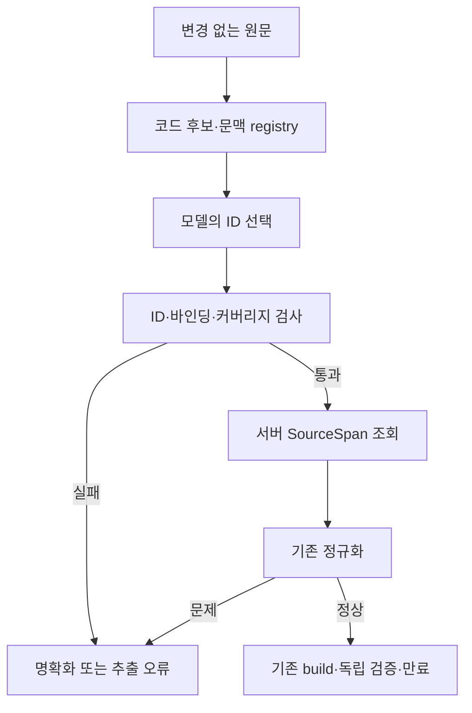

# 후보 구간·ID 선택 어댑터 설계안

2026-10-20 / 데모 W3·Stage 4-A. **설계 초안이며 코드·확정 운영 계약이 아니다.** 사용자 확정은 코드가 원문 후보 구간/ID를 만들고 모델이 ID를 선택하는 방향의 설계, 기존 정규화·엔진의 원문 검증 유지, 추가 모델 호출 없음이다. 아래 후보 생성 문형·추가 제한·출력 프로토콜은 구현 전 확인할 제안이다.

## 문제와 목표

[실제 두 모델×5회 시험](ollama-extraction-comparison.md)은 JSON 구조 5/5씩을 통과했지만 전체 구간/근거/정규화 의미가 모두 0/5였다. 인덱스뿐 아니라 접두어/조사 포함, 금액 분절, 강화 목록 분리, 필드 오분류가 있었다. 따라서 모델이 만든 위치를 문자열 검색으로 고치는 접근은 채택하지 않는다. 모델이 선택할 수 있는 근거 자체를 서버가 원문에서 먼저 고정한다.

기존 `SourceSpan`, `ExtractedConditions`, 금액·급여·강화·정식값 파서, `normalize_conditions`, 그래프의 오류 전 자료 접근 차단, 스냅샷/CP-SAT/독립 검증·만료는 유지한다. 어댑터는 선택 ID를 서버가 보유한 SourceSpan으로 변환하는 추출 경계에만 둔다. 과거 직접 구간 어댑터와 실패 기록은 보존하고 자동 fallback하지 않는다.

## 한 요청의 처리

1. 원문을 수정하지 않고 기존 Python 코드포인트 4,000자/공백 입력 검사를 적용한다.
2. 코드가 허용된 문형·토큰 규칙으로 후보 구간과 문맥 구간을 만든다. 각 객체의 start/end/text를 원문과 직접 대조하고 후보집합을 고정한다.
3. 모델에는 원문과 후보 ID/문자열/문맥 관계를 제공한다. 모델은 인덱스·근거 문자열·정규화 숫자를 생성하지 않고 ID만 선택한다.
4. 코드가 출력 구조·후보집합 바인딩·ID 존재·중복/재사용·필드 적합·문맥 커버리지를 확인한다. 실패하면 이 요청은 명확화/추출 오류로 종료한다.
5. 선택한 ID마다 저장된 SourceSpan을 조회해 `ExtractedConditions`를 만든다. 후보의 모든 출현을 자동 채택하거나 유사 ID/문자열을 추측 복구하지 않는다.
6. 기존 `normalize_conditions`를 그대로 실행한다. 누락·미지원·충돌·원문 불일치가 하나라도 있으면 자료 공급기/엔진에 접근하지 않는다. 정상 결과만 기존 build로 전달한다.

다음은 제안 흐름이며 아직 구현된 그래프가 아니다.

## 후보와 출처 바인딩

제안하는 내부 registry는 `CandidateSet`(불변)과 두 종류의 항목이다.

| 자료 | 필드/의미 |
|---|---|
| 요청 원문 | 변경 없는 original, source_sha256 |
| 후보집합 | candidate_set_id, 생성기/문형/프로토콜 버전, 정렬된 후보/문맥 목록과 내용 해시 |
| 값 후보 | opaque candidate_id, 기존 SourceSpan, 가능한 필드 종류, 문맥 ID, 생성 규칙 ID, 파서 검사 결과 |
| 문맥 구간 | opaque context_id, 원문 구간, 속한 값 후보 IDs, 남은 원문 토큰/상태 |

ID는 한 후보집합 안에서만 의미가 있다. 위치가 다른 반복 문자열은 서로 다른 ID다. 모델이 같은 문자열을 반환하더라도 전 출현으로 확장하지 않는다. 서버는 현재 요청의 불변 registry를 직접 사용하며 모델이 되돌린 해시만 신뢰하지 않는다. 요청/원문/후보 생성 규칙이 달라지면 다른 후보집합으로 취급한다.

후보 ID를 숫자 순서로 추측해 보정하거나 이전 요청의 registry를 재사용하지 않는다. 정확한 ID 길이/인코딩은 내부 구현 선택으로 고정·해시하고 모델 비교 전에 동결한다. 웹에 이 registry나 원본 모델 출력을 그대로 노출하지 않는다.

## 후보 생성 — 첫 구현 전 확인할 제안

첫 버전은 통제된 문형부터 시작하는 안을 권장한다. 예: `예산 <금액>, 급여 <정수>, <정식 클럽>, <하이픈 포메이션>, <강화 표현>으로 구성해줘.` 누락/중복 조건과 미지원 절도 자료로 남긴다. 기존 five-case 입력을 최초 회귀 사례로 포함하되 이 5개만 맞추는 모델 성능 기준으로 사용하지 않는다. 자유 한국어 전체를 결정론적으로 분석한다고 주장하지 않는다.

- 금액: 기존 정확 금액 문법의 전체 표현을 하나로 묶는다. `1조 5천억`을 별개 예산 후보로 만들지 않는다. `1조5000`에서 유효 접두어 `1조`만 잘라 정상 후보로 만들지 않는다. 관련 표현 전체를 오류/미해결 문맥으로 남긴다.
- 급여: 값 후보에는 정수 부분만 담고 `급여`는 문맥 표식으로 보존한다. 금액 숫자와 급여 숫자의 단순 전역 수집은 하지 않는다.
- 클럽/포메이션: 기존 정식 지원값만 값 후보로 만들되 부정·제외·비교 표현이 붙은 문맥을 양성 조건으로 자동 승격하지 않는다. 별칭·좌우 확장·새 팀컬러는 도입하지 않는다.
- 강화: `5~11강`·`5강,7강` 전체를 각각 하나의 값 후보로 만든다. 목록 쉼표를 문장 구분 쉼표로 단순 분할하지 않는다. 4강 등 지원 밖 값은 조용히 버리지 않고 원문 문맥과 오류 근거로 남긴다.
- 구분자: `150,000BP`의 쉼표·강화 목록 쉼표를 보호한 뒤 명시 문형 경계를 판정한다. 모든 쉼표/공백으로 자르는 구현은 금지한다.
- 반복/충돌: 출현별 후보를 보존한다. 코드가 최신 예산/마지막 값을 정하거나 같은 문자열 전 출현을 자동 선택하지 않는다. 모델이 한 출현을 누락하면 문맥 커버리지 실패로 처리하는 안이다.
- 후보로 표현하지 못한 절은 원문 문맥/미해결 조각으로 남긴다. 후보가 없다는 이유로 조건이 없었다고 간주하지 않는다.

새 후보집합 수 상한은 예를 들어 값 후보 128개·문맥 64개가 가능한 운영안이다. 아직 사용자 확정값이 아니다. 초과 시 자르거나 앞부분만 채택하지 않고 요청 전체를 명확화로 반환하는 방향을 제안한다. 기존 4,000자/금액 100자 한도는 유지하며 새 수치·초과 응답은 구현 전에 확인한다. 모든 부분 문자열을 후보로 만드는 O(n²) 방식은 사용하지 않는다.

## 문맥 커버리지와 놓친 조건

ID 선택만으로 의미 정확도를 보장할 수 없다. 특히 모델이 `급여 제한 없음`·`리버풀 제외`·`빠른 선수`를 무시하고 정상 값 ID만 고르는 실패가 가능하다. 이를 숨기지 않도록 문맥을 별도로 검증하는 안이다.

- 모든 비구분 원문 조각을 값 근거·허용된 문형 표식/요청 표현·미지원·미해결 중 하나로 추적한다.
- 모델은 문맥별로 선택된 근거 ID와 분류를 반환한다. 분류가 조건이면 해당 문맥 안의 실제 선택 ID를 요구한다. 연관 없는 원문의 ID를 문맥 근거로 쓰지 못하게 한다.
- `request_filler` 같은 무시 분류는 코드가 정확히 확인한 좁은 문형 표현에만 허용한다. 모델의 자유로운 “중요하지 않음” 판정으로 원문을 버리지 않는다.
- 남은 조각이나 부정/수정/비교가 있는 문맥, 모델 누락/미분류 문맥은 기본값으로 채우지 않고 명확화를 요청한다. 전체 문맥 자동 정상 표시는 허용하지 않는다.
- 미지원 절은 그 원문 구간을 기존 unsupported 근거로 보존한다. 새 제품 조건이나 선수 제외 기능을 엔진에 추가하는 승인이 아니다.

정확한 허용 문형/요청 표현 목록과 부정·수정 표현 처리 범위는 **설계상 미확정**이다. 안전한 커버리지는 자연스러운 문장 일부도 거부할 수 있다. 이 보수적 UX와 범위를 사용자에게 확인하고, 확인 전 구현 완료/자유 한국어 지원으로 표시하지 않는다.

## 모델 출력과 검증 제안

제안 버전은 `candidate-selection.v1`이며 실제 API/웹 계약을 바꾸는 버전이 아니다. 기존 여섯 필수 필드 이름을 유지하되 price_cap/salary_cap/team_color/formation/allowed_reinforcements 배열은 값 후보 ID만, unsupported 배열은 미지원 절의 문맥 ID만 담는 안이다. ID 종류가 다른 필드로 들어가면 거부한다. 값/문맥 ID namespace도 구별한다. 추가로 candidate_set_id와 문맥별 선택/분류를 반환하는 출력 구조를 제안한다. 정확한 필드명과 문맥 분류 enum은 구현 전에 문서/합성 정답으로 고정한다.

- 필수 누락·추가 필드·중복 JSON 키·잘못된 타입·미등록/다른 후보집합 ID를 거부한다.
- 동일 ID의 중복, 상호 모순되는 필드 배정, 문맥과 다른 선택을 오류로 보고 보정하지 않는다.
- 필드에 선택된 ID가 해당 후보의 가능 필드와 맞아야 한다. 코드의 가능 필드 레이블은 문형상 제약이지 선수 추천 조건의 진실로 사용하지 않는다.
- 파서 오류/미해결 문맥이 있는 후보는 정상 조건으로 승격하지 않는다. 미지원/오류를 사용자가 고칠 수 있게 보고한다.
- 필수 조건 배열이 비어 있으면 기존 missing을 유지한다. 반복된 서로 다른 값은 기존 ambiguous로 전달한다. 한 강화 목록 후보를 여러 독립 강화 조건으로 바꾸지 않는다.
- ID를 SourceSpan으로 매핑한 뒤에도 원문·구간·정규화 검증을 재실행한다. registry 손상/다른 요청 혼입을 방어하고 변경 없는 기존 검증기를 마지막 기준으로 삼는다.

모델 장애·생성 길이 제한·프로토콜 오류 뒤 직접 구간 어댑터로 대체하거나 재호출하지 않는다. 실제 모델/추론 설정·timeout·재시도 정책을 이 설계로 새로 확정하지 않는다. 승인된 지난 10회는 소진됐고 추가 실제 비교는 별도 범위를 정해야 한다.

## 기존 추출 인터페이스와의 간극

현재 `ConditionExtractor.extract(original) -> ExtractedConditions`는 성공 근거 또는 `ExtractionError`만 전달한다. 현재 그래프는 ExtractionError를 안전한 기술 오류로 처리하며, 새로운 후보 초과/미해결 문맥을 사용자 명확화 사유로 세분화하는 계약은 없다. 이 간극을 구현 완료로 간주하지 않는다.

제안은 순수 준비/선택 검증 결과에 ready·input_issues·provider_error를 구분하는 내부 타입을 두고, 통합 래퍼/노드가 input_issues일 때 기존 자료·엔진 호출 전에 종료하는 것이다. ready의 SourceSpan만 기존 추출 성공 계약/정규화로 전달한다. 새 사유를 기존 normalizer가 생성한 것처럼 버전을 붙이거나, 미해결 문맥을 빈 근거/missing으로 숨기지 않는다. 새 래퍼/노드·결과 타입·명확화 사유와 API 직렬화는 별도 후속 범위로 확인한다. 기존 추출기/정규화 공개 계약과 단위 테스트는 유지한다.

ID 선택 자체도 필드 오분류나 누락을 일으킬 수 있고 후보 생성기가 잘못되면 모델이 올바른 근거를 고를 수 없다. 프롬프트 주입이나 자유 한국어 의미를 해결했다고 주장하지 않는다. 후보 생성 정확도와 문맥 커버리지를 먼저 합성으로 검증한 뒤 새 승인 비교로 효과를 측정한다.

## 오류 경계와 보존 계약

원문 길이/후보 초과/미해결 문형·누락·미지원·모호성은 사용자 입력 명확화, 모델 연결/기한/잘못된 출력은 안전한 추출 오류로 구분하는 안이다. 정확한 새 사유 코드는 후속 구현 계약에서 고정한다. 기존 오류를 성공으로 감추거나 웹의 현재 v0 mock DTO를 먼저 바꾸지 않는다.

후보집합·출력 선택·검증 기록에는 원문/후보/버전 해시와 실패 코드를 연결한다. 실제 프롬프트/응답/상세 관측은 기존 Git 제외 로컬 보관을 유지한다. 외부 tracing·다운로드·실데이터/개인정보 전송을 승인하지 않는다. 기존 원문/배치/모델 산출물·관측 신선도를 수정하지 않는다.

## 구현·검증 순서 제안

| 증분 | 내용 | 완료 증거/경계 |
|---|---|---|
| C0 | 사용자 확인 후 문형·후보 상한·출력/커버리지 계약 고정 | 현재 문서는 설계만. 미정 항목은 사용자 답변과 분리 |
| C1 | 순수 후보 생성기·불변 registry | 원문 구간 정확 일치·반복별 ID·결정론/해시·유효 접두어 부분 채택 금지. 외부 I/O 없음 |
| C2 | ID 출력 검증·SourceSpan 어댑터 | 외래/중복/누락 ID·오분류·미분류 문맥·변조 거부, 기본값/전 출현 자동확장 없음 |
| C3 | 테스트 대역→기존 정규화/그래프 연결 | 정상 5조건·누락·미지원·충돌·잘못된 강화/금액·engine 미접근·기존 공개 계약 불변 |
| C4 | 새 승인으로 같은 5개와 사전 고정 경계 사례 비교 | 실제 모델/샘플 수/시도 상한을 먼저 확인. 이전 결과/실행 잠금 유지 |

합성 테스트에는 금액 쉼표와 강화 목록 동시 등장, 같은 값 반복/서로 다른 예산, Unicode/다중 코드포인트, 4,000자/금액 100자 경계, 부정/선수 제외/수정 절, 등록되지 않은 문형, 후보 초과, 다른 요청 ID 혼입을 포함한다. 후보 정확도·필드 선택·커버리지·최종 의미를 분리한다. 같은 형식의 JSON을 반환했다는 이유로 성공을 계산하지 않는다. 전체 pytest/Ruff/최신 head CI와 독립 검증/만료를 유지한다.

## 현재 확정과 남은 결정

확정: 후보 구간·ID 선택 방향의 **설계만**, 정규화/엔진의 기존 원문 검증 유지, 추가 모델 호출 없음.

구현 전 확인: 첫 허용 문형/요청 표현·부정/수정/커버리지의 UX, 새 후보 수 상한·초과 처리, 선택 출력/새 사유 코드, 실제 구현 증분 범위. 실제 비교 전에는 모델/설정·사례·총 시도·기한·재시도/중단을 별도로 확인한다. 이번 설계를 기존 제품 요구사항의 자동 확정이나 구현 승인으로 취급하지 않는다.
