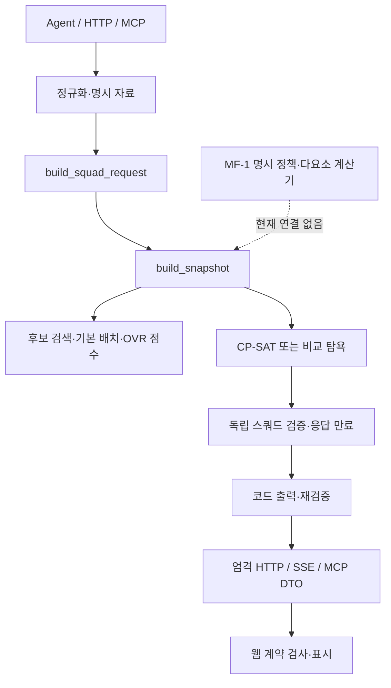

# MF-3 연결 전 영향 분석

2026-10-23 사용자 요청. 기준은 develop `6446504ce4cb42614b2ff2de21df1a054ca24f2d`다. [설계도 §5 D7](FRS_2.0_설계도.md), [MF-0 설계](multi-factor-performance-design.md), [MF-1 구현](multi-factor-performance-implementation.md), [OVR 동점 예산 계약](budget-tiebreak-contract.md)과 현재 소스를 대조했다.

**이번 결과는 변경 지점·결정 목록·검증 계획이다. MF-3 구현이나 운영 점수 변경은 하지 않았다.** MF-2 실제 선호 평가는 다른 담당이 수행한다. 그 판단·보고서·실제 관측 파일은 열거나 수정하지 않았으며, 이 문서에는 선호 일치율이나 품질 결론을 넣지 않는다. D1 실데이터 경로·기본 합성 경로·1-D/1-F 미완료·종료 실행/잠금·관측 상태와 기한은 유지한다.

## 1. 확인 결과

연결은 계산기 호출 하나의 교체로 끝나지 않는다. 현재 OVR 전제가 서로 다른 계층에 들어 있다.

1. 스냅샷과 검증기가 `raw_ovr`·`performance=OVR/2`를 고정한다. MF-1도 현재는 OVR이 없는 후보를 먼저 제외한다.
2. CP-SAT의 주 목적·가격 보조 목적의 고정값·성능 탐욕·경계/간극이 모두 OVR 기준이다. 새 점수의 동점 안에서 가격을 최적화할지는 별도 결정이다.
3. API는 `performance=raw_ovr/2`를 검사한다. 웹은 0.5 단위 점수만 받고 화면에서는 소수 한 자리로 표시한다. MF-1의 0.01점 값을 기존 필드에 넣으면 계약이 맞지 않는다.
4. 기존 합성 엔진 벤치마크와 합성 Agent 자료는 준비 상태가 다르다. 전자는 능력치가 일부뿐이고, 후자는 34개 능력치는 있지만 양발 정보를 생성하지 않는다. 새 검증 자료가 필요하다.
5. MF-2의 카드 두 장 선호 측정만으로 11명 합산·포지션 간 예산 배분·탐색 지연이나 서비스 적용을 검증했다고 볼 수 없다.

아래에서 **현재 사실**은 소스에서 확인한 동작, **제안**은 후속 구현안, **결정 대기**는 사용자가 확정해야 하는 범위다. 문서 병합으로 제안을 채택하지 않는다.

## 2. 현재 호출 경로

추천용 `build.py` 경로가 분석 대상이다. 과거 독립 실행 코드 `recommend.py`나 등록 포지션 예측 모델을 이 경로의 점수 공급기로 사용하지 않는다. 모델의 포지션 확률을 점수나 선호 정답으로 쓰는 변경도 없다.

## 3. 계층별 변경 지도

### 3.1 정책·후보·스냅샷

| 현재 소스·심볼 | 현재 사실 | 후속 변경 제안과 확인할 점 |
|---|---|---|
| [multi_factor_policy.py](../FRS/core/squad_recommend/multi_factor_policy.py) `ScoringPolicy.spec/version` | 정책 내용·알고리즘 의미·단위가 해시에 들어간다. `status=experimental`, 두 모드와 슬롯별 프로필을 검증한다 | 선택 정책의 ID와 기대 해시를 요청 실행 문맥에 고정한다. 예제 파일 자동 선택·최신 정책 선택·묵시적인 body 전환을 만들지 않는다 |
| [multi_factor.py](../FRS/core/squad_recommend/multi_factor.py) `score_multi_factor`, `MultiFactorResult` | 정확 유리수·최종 HALF_UP·정수 `score_units`·구성 기여·입력 해시·관측 참조·필드별 제외가 있다. 기존 OVR 적격성을 먼저 검사한다 | 계산기를 재구현하지 않고 불변 결과를 연결한다. OVR 없는 후보 지원을 원하면 적격성 분리부터 별도 변경해야 한다 |
| [search.py](../FRS/core/candidate_search/search.py) `candidate_search` | 명시 배치·정확 등록 포지션·관측·가격·급여·자격으로 후보를 모은다. 현재 OVR 상위 K개 절삭이나 OVR 순 정렬은 없다 | 현재 검색 경계는 보존하고 점수 판단은 후단에 둔다. 성능 최적화 명목으로 OVR 절삭을 새로 넣지 않는다 |
| [snapshot.py](../FRS/core/squad_recommend/snapshot.py) `SnapshotQuery`, `snapshot_spec`, `build_snapshot` | 요청에 점수 모드/정책이 없다. OVR scorer 버전과 점수를 고정하고, 후보의 원관측 전체를 불변 bytes에 보관한다 | 모드·정책 내용/기대 해시·프로필·점수 단위·입력 해시를 함께 고정하는 구조를 정한다. 정책 해시가 `snapshot_id`에 반영되어야 한다. 후보별 점수만 추가하고 정책 원문이나 재현 가능한 명시 바인딩을 빼면 검증기가 재계산할 수 없다 |
| [performance.py](../FRS/core/squad_recommend/performance.py), [placement.py](../FRS/core/squad_recommend/placement.py) | OVR 키 대응과 기본 배치 판정은 별도 계약이다. MF-1은 OVR 조회 경계를 재사용한다 | 기존 OVR 모드는 유지한다. 새 점수/프로필 대응을 포지션 배치 확장이나 모델 확장으로 사용하지 않는다 |

**제외·기한의 제안:** MF-1의 추가 제외(`missing_feature`, `missing_stat_delta`, 범위 오류, 양발/체형 오류 등)를 카드·강화·슬롯과 필드 사유로 보존한다. 기존 검색 제외와 점수 제외를 구분해 중복 집계하지 않는 계약이 필요하다. 한 슬롯의 실패로 다른 유효 후보까지 버리거나 OVR로 대체하지 않는다. 정책 전체 오류와 카드별 자료 오류도 구분한다.

현재 기한은 **선택된 11명뿐 아니라 스냅샷에 포함된 모든 유효 후보의 사용 관측** 중 가장 이른 기한이다. 새 점수로 제외된 후보의 관측은 사용 집합에서 빼고, 새 점수 계산에 실제 사용한 관측은 포함해야 한다. 원래 관측 상태/시각/기한·명시 배치·동일 원관측 연결은 그대로다. 정책 파일 버전은 관측의 만료를 연장하는 근거가 아니다.

### 3.2 탐색·탐욕·독립 검증

| 현재 소스·심볼 | 현재 사실 | 후속 변경 제안과 확인할 점 |
|---|---|---|
| [solver.py](../FRS/core/squad_recommend/solver.py) `engine_spec`, `solve_squad` | 주 목적은 `sum(raw_ovr)`다. `optimal`은 이 주 목적의 증명이다 | 다요소 모드에서 `sum(score_units)`를 쓰려면 별도 목적 식별자·엔진 사양과 상태 의미를 명시한다. 현재 OVR 모드의 목적을 전역 교체하지 않는다 |
| 같은 파일 `_maximize_price` | 최적 OVR 합을 고정하고 가격을 최대화한다. 주/보조 탐색이 10초를 공유하며 가격 상태는 `not_run/optimal/incomplete`다 | 새 점수의 최적 합 고정으로 바꿀지 결정한다. 새 점수로 주 탐색하고 OVR 합으로 보조 탐색을 고정하는 혼합은 금지하는 안이다. 주 목적 미증명 때 보조 탐색하지 않는 동작·정확 BP·기존보다 비싼 동점 해 유지·시간 공유를 보존한다 |
| 같은 파일 `_finish`, `EngineResult` | `best_bound`와 `absolute_gap`은 OVR 기반 경계/차이를 2로 나눈 성능 단위다 | 새 목적에 맞는 경계·간극의 단위와 직렬화를 정의한다. 100단위 정수 목적에 `/2`를 남기지 않는다. 주 목적 경계를 가격 탐색의 경계로 덮어쓰지 않는다 |
| 같은 파일 `greedy_squad` | 최저가 또는 `-raw_ovr`, 이후 spid·강화 순으로 고르고 되돌리지 않는다 | 성능 탐욕만 새 모드의 `-score_units`로 바꾸는 안이다. 최저가 순·동점 순서와 `greedy_failed` 의미는 유지한다. 비교 방식은 같은 정책·후보·제약을 사용해야 한다 |
| [validator.py](../FRS/core/squad_recommend/validator.py) `SnapshotCandidate`, `_read`, `validate_squad` | 원관측의 배치·강화·가격·자격·기한·배치 허용을 확인하고 OVR scorer로 후보 값을 재계산한다. 메타데이터는 현재 `snapshot_spec()`과 정확히 대조한다 | 모드별 엄격 후보/메타 계약과 검증 분기를 정한다. 정책·프로필·입력 해시·정수 점수·구성 근거를 원관측에서 재산출한다. solver가 제출한 합계나 구성 기여를 신뢰하지 않는다 |
| 같은 파일 `ValidatedPlayer`, `ValidationReport` | 검증된 선수·총 OVR과 `performance=total_ovr/2`를 반환한다 | 기존 OVR 진단과 새 목적 합계를 구분한다. MF-1은 0점도 유효하므로 양수 OVR 조건을 새 점수에 복사하지 않는다. 무효/만료 결과에는 선수·합계를 남기지 않는다 |

11명·정확한 슬롯·person_id 중복 금지·클럽 양성 자격·허용 강화·가격/급여 합계 제약과 34자리 BP 처리는 바꿀 이유가 없다. 특히 새 점수와 가격을 큰 계수 하나로 합쳐 가중 목적을 만들면 주 목적 1unit을 가격과 맞바꿀 수 있으므로, 결정할 목적 우선순위와 다른 구현이 된다.

현재 “독립 검증”은 **탐색기의 선택 결과와 독립하여 원관측/제약을 재검증**한다는 뜻이다. OVR 점수 재계산은 같은 scorer 함수를 호출한다. MF-3에서도 이 구조만으로 점수 산술까지 다른 구현으로 대조했다고 보고할 수 없다. 산술의 독립 수기/유리수 오라클과 작은 조합 전수 탐색을 별도 검증 축으로 둔다.

### 3.3 요청 조립·출력·HTTP/SSE·MCP·웹

| 현재 소스·심볼 | 현재 사실 | 후속 변경 제안과 확인할 점 |
|---|---|---|
| [build.py](../FRS/core/squad_recommend/build.py) `build_spec`, `build_squad_request` | 정규화 후 명시 문맥으로 스냅샷·CP-SAT을 호출한다. 점수 정책 인자가 없다 | 명시 점수 실행 문맥의 전달 경계를 정한다. 정규화 실패 시 자료/탐색을 사용하지 않는 경계와 기존 기본 동작은 보존한다 |
| [graph.py](../FRS/agent/graph.py), [candidate_graph.py](../FRS/agent/candidate_graph.py), [agent_runtime.py](../FRS/api/agent_runtime.py) | Agent/어댑터 사양은 하위 사양을 참조한다. 서비스 설정은 자료 모드·명시 실행·모델을 다루며 점수 모드 선택은 없다 | 서버가 허용한 명시 모드/정책을 전달할 위치를 결정한다. LLM에게 가중치·프로필·정책 해시를 만들게 하지 않는다. 기존 필수 조건·급여310·모델 호출 수·오류 시 자료 접근 차단을 유지한다 |
| [presentation.py](../FRS/agent/presentation.py) `presentation_spec`, `present_agent_result` | 출력 전 스냅샷·선택·합계를 다시 검증한다. 가격 최적 미확정 문구가 “동일 OVR”로 고정돼 있다 | 새 목적의 검증 결과·정확 점수·정책 출처를 투영한다. 목적 식별자에 맞춰 문구를 바꾸고 합성/관측 출처를 유지한다. 선수 선택만으로 승률·경기 성능 개선을 주장하지 않는다 |
| [agent_contract.py](../FRS/api/agent_contract.py) `WebRow`, `WebSquad`, `WebFinal` | `web-agent.v1`의 엄격 DTO다. 행의 `performance=raw_ovr/2`, 11명 합계·조건·버전을 검사하고 추가 필드를 거부한다 | 새 모드의 필드·단위·불변식·차기 wire 계약과 기존 v1 처리 범위를 결정한다. `performance`의 의미만 조용히 교체하거나 기존 DTO 검사를 완화하지 않는다 |
| [agent_projection.py](../FRS/api/agent_projection.py), [agent_events.py](../FRS/api/agent_events.py) | 내부 결과 중 고정 필드만 외부로 투영한다. 요청/SSE 버전과 직렬화 직전 만료를 검사한다 | 내부에 필드를 추가해도 자동 노출되지 않는다. 요청 선택 범위·최종 DTO·버전 전달·이벤트 계약을 함께 검토한다. 스트림 오류·만료에 성공 표를 남기지 않는다 |
| [mcp/contract.py](../FRS/mcp/contract.py), [mcp/service.py](../FRS/mcp/service.py) | `mcp-build.v1`은 `WebSquad`를 공유하며 자체 엄격 출력·합성 서비스·직렬화 직전 만료가 있다 | 웹 DTO 변경을 MCP와 무관하다고 볼 수 없다. MCP는 기존 모드로 고정할지, 별도 버전으로 노출할지 결정한다. 도구의 기존 원문/ID 선택 계약을 임의 확대하지 않는다 |
| [webAgentV1.ts](../frontend/src/contracts/webAgentV1.ts) `halfStep`, `parseRow`, `parseSquad` | 추가 필드와 0.5 단위 밖 점수를 거부한다. 가격/급여는 정확한 문자열·BigInt로 검사한다 | 새 버전/정수 점수 계약을 따로 검증하고 기존 v1 거부 규칙은 유지한다. 웹에서 정책 계산이나 반올림으로 서버 값을 보정하지 않는다 |
| [format.ts](../frontend/src/utils/format.ts) `formatScore`, [SquadTable.vue](../frontend/src/components/SquadTable.vue), [FormationPitch.vue](../frontend/src/components/FormationPitch.vue), [ResultView.vue](../frontend/src/components/ResultView.vue), [App.vue](../frontend/src/App.vue) | 표시는 소수 한 자리이며 표·피치·합계·최적 안내·요청 안내가 OVR 중심이다 | 새 점수의 두 자리 표시·OVR 진단 구분·합계/평균 이름·최적 상태 설명을 검토한다. pitch의 OVR 숫자를 새 점수로 바꾸려면 범례도 함께 정한다 |

예를 들어 MF-1 합성 예시의 OVR128 카드는 새 점수6378units, 즉63.78점이다. 기존 API의 요구값64점과 다르고, 웹 `halfStep`에도 맞지 않는다. 단지 소수 한 자리로 표시하면63.8점이 되어 원래 계산 결과와도 달라진다. **기존 `performance` 필드에 대입하는 방식은 호환 이행안이 아니다.**

## 4. 점수 단위와 버전 경계

다음 수치는 **현재 MF-1 계산기의 사실**이다. MF-3 목적/출력으로 채택하는 결정과는 구분한다.

| 값 | 현재 의미 | MF-3에서 필요한 구분 |
|---|---|---|
| `raw_ovr` | 목표 강화·점수 조회 포지션의 절대 OVR | 원래 의미를 보존하며 새 점수로 덮어쓰지 않음 |
| MF-1 `score_units` | 0~10000 정수, 1unit=0.01점 | 탐색용 정확 값 후보. 0도 유효하며 bool/float를 정수로 받아들이지 않음 |
| MF-1 `display_score` | `score_units/100`의 두 자리 문자열 속성 | 현재 자동 wire 필드는 아님. 출력 계약을 별도로 정함 |
| 새 목적 합계 제안 | 11명 `score_units` 합, 0~110000units | 표시 합계는0~1100점. 선수 평균0~100점과 다른 이름·단위 필요 |
| 경계·간극 제안 | 선택한 주 목적 기준의 상한과 잔여 차이 | OVR 단위·점수 units·표시 점수·BP 경계를 혼용하지 않음 |

정수 합산안을 채택한다면 카드마다 MF-1이 최종 양자화한 `score_units`를 합한다. 구성 항목별로 먼저 반올림하거나 11명의 정확 유리수를 먼저 더해 마지막에 한 번 양자화하는 다른 목적과 섞지 않는다. 합계 표시는 이 정수 합을 기준으로 만든다.

역할마다 같은0~100 범위를 쓴다는 사실만으로 역할 간 가치가 교정된 것은 아니다. 단순 합산을 채택하려면 포지션 사이의 점수 분포·한 자리 향상/다른 자리 손실·예산 배분 사례를 별도로 확인해야 한다. 새 슬롯 가중치나 선택형 역할을 조용히 추가하지 않는다.

**버전 전파 제안:** 정책 내용/기대 해시 → 모드별 스냅샷 사양과 `snapshot_id` → 목적/정밀도/동점 의미를 담은 엔진 사양 → build → graph/candidate adapter → presentation/projection/event → 해당 wire/웹·MCP 계약을 확인한다. 현재 사양 함수들은 하위 버전이나 DTO 스키마를 참조하므로 출력 문구만 바꿔도 일부 해시가 달라진다. 정책을 포함한 버전과 알고리즘 버전의 책임을 명시하고, 서로 다른 정책/모드 결과가 섞이면 거부하는 계약이 필요하다.

특히 현재 `_read`는 현재 `snapshot_spec()`과 메타데이터를 대조한다. 전역 사양을 새 모드로 덮어쓰고 이전 OVR 스냅샷도 그대로 읽힌다고 가정하면 안 된다. 기존 경로/사양 유지, 모드별 엄격 디스패치, 지원하지 않는 과거 버전 거부 중 실제 지원 범위를 명시해야 한다. 과거 파일/리포트는 보존하고 새 기록으로 분리하며, 최신 버전 자동 대체나 기존 해시 재작성으로 맞추지 않는다.

## 5. 합성 자료·벤치마크 준비

| 현재 소스 | 확인한 부족분 | 준비 제안 |
|---|---|---|
| [benchmark.py](../FRS/core/squad_recommend/benchmark.py) `build_case`, `exhaustive_optimum`, `summarize` | 기본 능력치/강화 delta는 `speed`만 있다. 양발 등 메타데이터는 생성하지 않는다. 전수 목적·비교 지표는 OVR 합이다 | 기존 OVR60문제·기록은 유지하고 별도 다요소 문제 생성기/목적 오라클/지표를 만든다. 모델의 예측이나 scorer 출력 자체로 정답을 만들지 않는다 |
| [material.py](../FRS/agent/material.py) `generate_synthetic_material`, `synthetic_material_spec` | 34개 능력치·강화는 생성하지만 `player_metadata=not_generated_not_model_input`이며 양발·신체 정보가 없다 | 새 모드용 가상 양발/필요 메타데이터·생성 사양/시드를 별도로 고정한다. OVR 데모 자료를 임의 보충·재생성해 과거 결과가 달라지게 하지 않는다 |
| [fixtures.ts](../frontend/src/mocks/fixtures.ts), [계약 테스트](../frontend/tests/contract.test.ts) | 모의 행·합계는 `OVR/2`다 | 새 계약의 합성 fixture와 오류 fixture를 따로 만들고 서버 기준의 출력과 대조한다 |

MF-2의 실제5강 카드 비교 세트는 엔진의 가격·급여·자격·강화5~11·11명 조합 검증용 fixture를 대신하지 않는다. 새로운 합성 자료의 범위·건수·품질/지연 기준은 후속 계약에서 고정한다. 기존 D6 합성60문제·p95≤1초를 MF-3 실측 결과나 운영 SLA로 재표기하지 않는다.

## 6. 후속 검증 행렬 — 계획이며 미실행

| 축 | 먼저 보존할 기존 검사 | 추가할 다요소 사례·완료 증거 제안 |
|---|---|---|
| 산술·강화·누락 | [test_multi_factor.py](../tests/test_multi_factor.py) | 0/10000units·최종0.005 경계·서로 다른 분모의 합·강화 delta 단1회·범위/필수 누락·body 비활성/활성. 독립 수기/유리수 산술과 대조 |
| 스냅샷 | [test_snapshot.py](../tests/test_snapshot.py) | 정책·프로필·단위·해시 고정, 원관측 불변, 같은 카드의 다른 슬롯/강화, 낮은 OVR/높은 새 점수 후보 보존, 추가 제외의 사유/분모, 순서 무관 해시, 제외 관측의 기한 미포함 |
| 탐색 최적성 | [test_squad_engine.py](../tests/test_squad_engine.py) | OVR 최대 해와 새 점수 최대 해가 다른 작은 문제, 1unit 우선·양자화 동점·전수 최적값·0점 유효해·동일 인물·11명/3포메이션·양 방식 탐욕 대비 비교 |
| 가격 보조 목적 | [test_budget_tiebreak.py](../tests/test_budget_tiebreak.py) | 채택 시 같은 새 점수 합 안에서 최대 사용액, 새 점수1unit을1BP와 교환하지 않음, OVR 합은 다른 동점 해, 주 feasible/보조 incomplete·10초 공유·34자리/1BP/자리올림·현재 유효해 악화 방지 |
| 독립 검증·상태 | [test_squad_engine.py](../tests/test_squad_engine.py) | 정책·구성·입력 해시·점수·합계 변조 거부, scorer 산술과 별도 오라클, feasible/optimal/unknown/infeasible/greedy_failed 구분, 재검증 후 만료 시 전체 성공 억제 |
| 출력·웹·MCP | [test_agent_presentation.py](../tests/test_agent_presentation.py), [test_agent_web_contract.py](../tests/test_agent_web_contract.py), [test_mcp_tools.py](../tests/test_mcp_tools.py), [웹 계약](../frontend/tests/contract.test.ts) | 새/이전 버전 혼합 거부·정수 단위/두 자리 문자열·합계/평균·추가 필드·목적 안내·점수 누락과0 구분·성공 근거/직렬화 직전 만료·백엔드/웹 fixture 대조 |
| 성능·재현 | [test_squad_benchmark.py](../tests/test_squad_benchmark.py) | 새 자료/정책/목적/코드 해시·작은 전수 대조·상태 정확도·후보 제외율·스냅샷/검증을 포함한 지연 측정. OVR 회귀와 새 목적 결과를 분리 |

전체 코드 검증은 기존 `python -m pytest`, `python -m ruff check .`, `python -m ruff format --check .`를 유지한다. 웹 변경 시 타입/단위/빌드와 계약 대조를 함께 수행한다. 합성 통과·선호 일치율·운영 품질은 다른 결과로 보고한다. 여기에는 새 사례/테스트 구현이나 벤치마크 실행이 없다.

## 7. 구현 전에 필요한 결정

아래 MF3-D1~D6는 이번에 식별한 **결정 대기 목록**이다. 기존 MF-D1~D5와 중복되는 주제를 구현 경계에 맞춰 나눈 것으로, 기존 결정을 뒤집거나 새 결정을 확정한 표가 아니다.

| ID | 정해야 할 내용 | 권장 출발점 — 미채택 제안 | 영향/선행 |
|---|---|---|---|
| MF3-D1 | 연결할 정책 내용/기대 해시·체형 적용 범위 | MF-2 담당이 고정한 명시 정책을 받고 `core-stat-foot`부터 검증. body-aware는 현실 선호 함수 확정 후 별도 | 모든 점수/자료·버전·산술 검증. 평가 과정의 가중치 조정이나 결과 해석을 이 작업에서 인수하지 않음 |
| MF3-D2 | OVR이 없는 후보를 허용할지 | 첫 연결에서는 현재 MF-1의 OVR 적격성 유지 | 허용하려면 MF-1 적격성 분리·nullable OVR·비교 분모·출력까지 범위 확대 필요 |
| MF3-D3 | 새 모드의 주 목적·정수 단위·11명 합산/역할 가치 | 기존 OVR 모드는 보존하고 명시 새 모드에서 0.01점 units 합을 최대화. 추가 슬롯 가중치는 두지 않는 안부터 검증 | 탐색/탐욕/독립 검증·경계/간극·역할 간 예산 배분·벤치마크 |
| MF3-D4 | 새 모드 동점에서의 가격 목적 | 새 점수 합의 최적 증명 후 그 합 안에서 사용액 최대화하는 사전식 목적 | 기존 “동일 OVR” 승인을 “동일 새 점수” 승인으로 확대하지 않음. OVR을 추가 동점 기준으로 넣을지도 임의 결정하지 않음 |
| MF3-D5 | 노출 범위·요청 선택 주체·차기 wire 버전·표시할 점수/근거 | 내부 검증을 먼저 마치고 새 계약에서 모드·정책 해시·행 정수 점수·정확 합계를 명시. 기존 v1의 의미 유지 | HTTP/SSE·MCP·웹의 범위와 이전 클라이언트 처리를 함께 확정. 구성 기여 전체/요약·평균·가격 최적 상태를 외부로 보낼지도 결정 |
| MF3-D6 | 실험/운영 적용 범위·품질/실행 조건 | 우선 합성 엔진 연결까지 구체화하고, 실제 제한 적용은 MF-2 결과와 한계·별도 실행 범위 확인 후 결정 | MF-2 측정만/`passed=null`은 운영 적용 통과 기준이 아님. 실제 추천·학습·모델 호출·DB/서버 교체·배포 권한을 새로 만들지 않음 |

자료 감사에 필요한 upper/약발표·반올림 의미는 현재 명시 MF-1 정책의 내용을 확인해 사용하며, 게임 공식 상한이라고 부르지 않는다. 다른 담당이 정책을 바꾸면 새 해시/정책을 받아 다시 고정한다. 점수 구성이나 품질 기준을 보류 평가 결과에 맞춰 이 문서에서 조정하지 않는다.

## 8. 구현 순서 제안과 단계별 산출물

1. **결정·입출력 계약 고정:** MF3-D1~D6 중 다음 증분이 의존하는 항목을 확정한다. 미정인 공용 노출은 내부 연결과 분리할 수 있다. 정책/모드/단위/허용 버전·오류·기존 OVR 보존 계약을 기록한다.
2. **합성 자료와 오라클 준비:** 필요한 가상 필드·강화·오순위/동점/자원 배분 사례를 고정하고 독립 산술/전수 기대값을 만든다. 기존 OVR fixture는 유지한다.
3. **스냅샷·독립 검증 연결:** 명시 정책과 점수 근거를 고정하고 원관측에서 재산출한다. 이 단계는 solver 목적 변경과 분리해 검증할 수 있다.
4. **새 목적·비교 탐욕 연결:** 주 목적·경계/간극·채택된 보조 목적을 같은 점수로 연결하고 작은 전수 대조를 통과시킨다. 기존 제약·시간 공유·OVR 회귀를 확인한다.
5. **내부 출력·버전 정합:** 합계/근거/최적 상태·기한을 재검증하고 build/graph/adapter/presentation 계층의 명시 버전을 맞춘다.
6. **승인된 외부 경계 연결:** 새 DTO·투영·이벤트/MCP·웹 fixture/표시를 함께 검증한다. 내부 결과가 있다는 이유만으로 현재 API에 노출하지 않는다.
7. **회귀·비교 측정 후 제한 적용 검토:** 기존 OVR 회귀와 별도 다요소 벤치마크를 기록하고 MF-2 결과/한계를 함께 검토한다. 실제 적용은 정해진 모드·배치·정책·실행 범위 안에서만 한다.

이 순서는 실행 계획 제안이다. 이번 사용자 요청의 완료는 영향 분석 문서이며, 위 구현을 자동으로 시작하는 요청으로 해석하지 않는다.

## 9. 이번 확인과 미실행

- 기준 커밋의 코드·정책/계약 문서·기존 테스트를 읽기 전용으로 대조했다. 독립 분석 문서와 설계도 §5/§11·공용 기록·MF-0 후속 링크만 변경한다.
- 분석 중 다른 담당의 MF-2 문서 PR #148이 develop `168a721270b831ef282ac5346424e7c2dd16bfbb`에 병합됐다. 이 후속은 문서3개만 바뀌었고 분석 대상 기능 소스에는 차이가 없다. 공용 기록은 양쪽 내용을 보존해 반영하며, 이번 분석에서 그 평가 결과를 재해석하거나 상세 보고서를 조회하지 않는다.
- 현재 식별자/함수·파일 경로·문서 링크·제안/확정 구분·Git diff·기능 파일 무변경을 확인한다. 문서만 변경하므로 로컬 기능 테스트/모델/엔진/벤치마크는 실행하지 않는다. PR의 기존 CI는 별도로 확인한다.
- 선호 판단/보고서·실제 관측·DB·모델·`.env`를 읽거나 수정하지 않았다. 새 수집/모델·metadata·외부 추적·서버/브라우저·학습·DB 쓰기·배포는 없다. GitHub 문서 PR/CI와 승인된 develop Squash 병합은 이 제한과 별개다.
- 품질 개선, MF-3 구현 완료, 실데이터 1-D/1-F 완료, master 병합/충돌 해결을 보고하지 않는다. 공용 기록 키는 `INT-MF3-001`이다.
